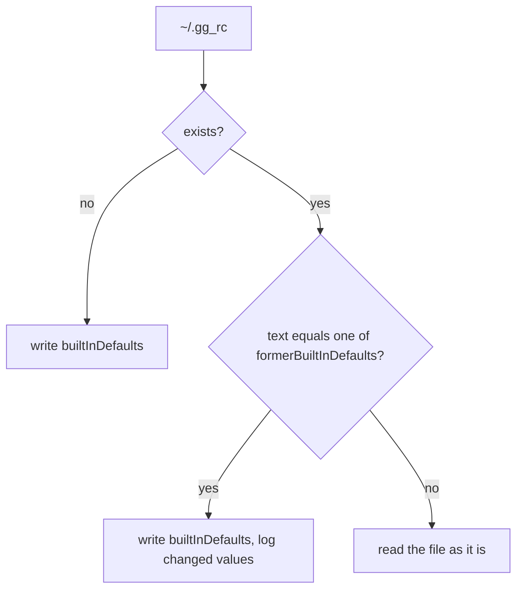

<!--
@license
Copyright (c) ggsuite

Use of this source code is governed by terms that can be
found in the LICENSE file in the root of this package.
-->

# do.add.transitive is off by default — also in old user files

## Motivation

- `GgRc.builtInDefaults` decides what gg does when neither the command
  line nor a settings file says otherwise
- `do.add.transitive` was `true`: adding repositories also added every
  repository between them in the dependency graph. Those are only needed
  when a release breaks its dependents; most of the time they only make
  the work bigger and slower
- The default is now `false`
- Changing a default in this class had a catch: `GgRc.load` writes the
  user file with every default spelled out the first time it runs. Every
  user who ran gg before holds `"transitive": true` in `~/.gg_rc` — not
  because they chose it, but because gg wrote it. A new built-in default
  would never reach them

## Strategy

- Change the built-in default
- Recognize a user file that nobody edited: its text is, character for
  character, what an older gg wrote
- Give such a file the current defaults; leave every other file alone
- Keep the list of what older versions wrote next to the defaults, so the
  next change of a default only has to append to it

## The new default

- `builtInDefaults`: `do.add.transitive` is `false`,
  `do.publish.askTicketCleanup` stays `false`
- A missing `~/.gg_rc` is written with these values, as before
- The examples in the messages and docs now show the setting that changes
  something: `{"do": {"add": {"transitive": true}}}`

## Files an older gg wrote

- `GgRc.formerBuiltInDefaults` lists what older versions wrote into a
  missing user file, oldest first: `{"do": {"add": {"transitive": true}}}`
  and the same with `do.publish.askTicketCleanup` false
- `GgRc.load` compares the text of an existing user file with each entry,
  pretty-printed exactly as gg writes it; Windows line endings count as
  the same text
- On a match it writes the current `builtInDefaults` into the file and
  logs one line naming the values that changed:
  `✓ Updated ~/.gg_rc to the new defaults of gg (do.add.transitive =
  false) …`
- The values of such a file are ignored either way — they are no choice
  of the user. A file that cannot be written only warns, and the current
  defaults apply all the same
- A file with any edit — a space, a comment, a value — is kept and read
  as before

## Smaller changes

- The walk over nested settings is one helper now, `_leaves`; finding a
  repository setting in the user file uses it too
- Tests cover each former entry, Windows line endings, an edited file and
  a file that cannot be written

## Open Points

- When a value of `builtInDefaults` changes again, append the old map to
  `formerBuiltInDefaults` — otherwise existing users keep the old value
- A user who wants the old behavior sets
  `{"do": {"add": {"transitive": true}}}` in `~/.gg_rc`; an edited file is
  never overwritten
